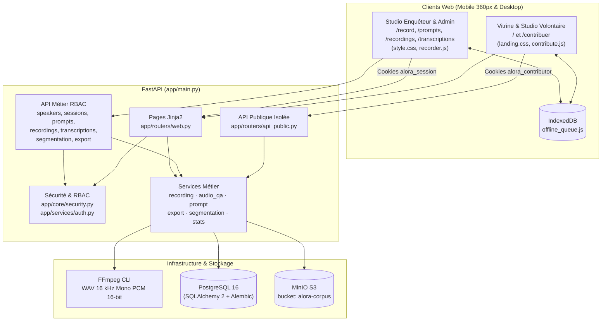
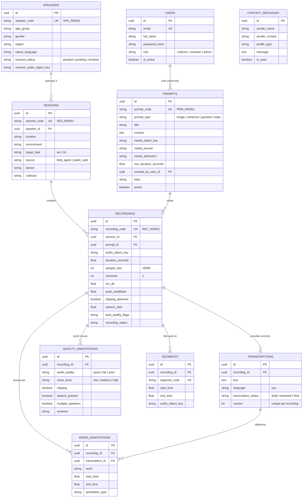
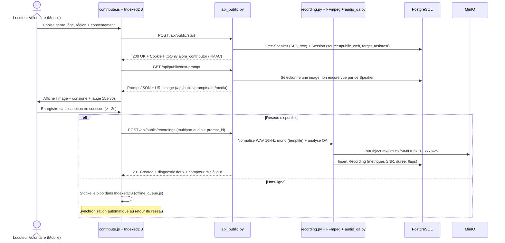
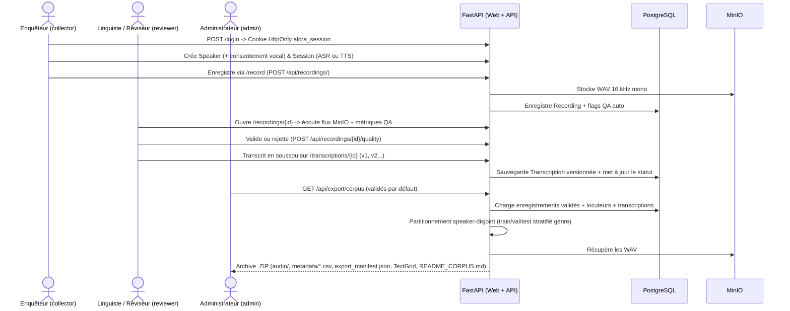
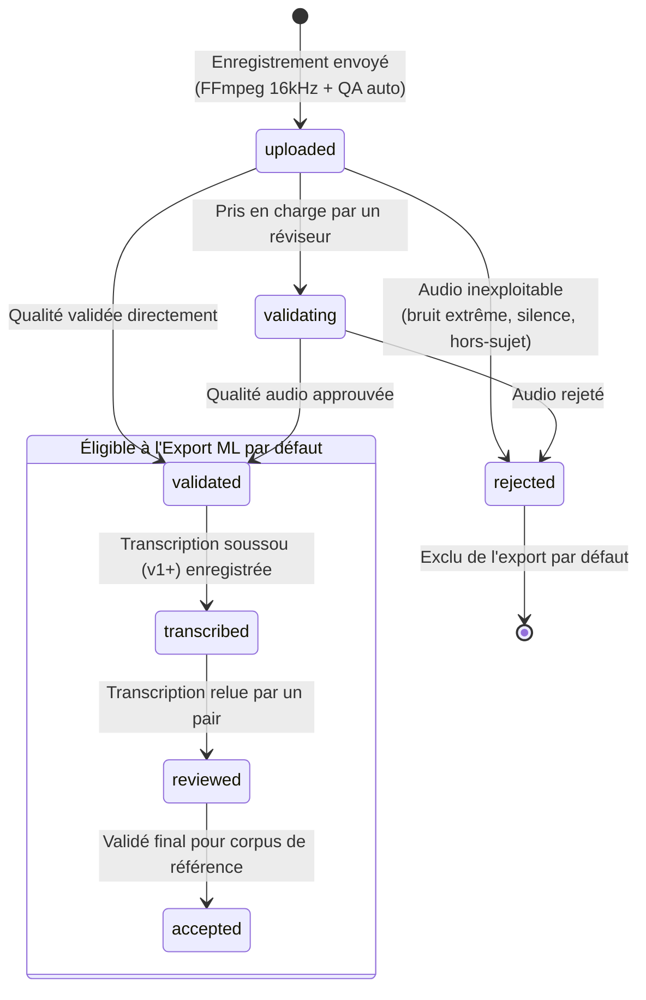

# Architecture & Guide Technique — ALORA

Ce document est la **carte mentale d'ALORA** pour les mainteneurs et contributeurs. Il regroupe l'architecture du système, les **schémas UML**, les flux principaux, une table **« Où modifier quoi ? »** et les pièges techniques déjà résolus.

---

## 1. Vue d'ensemble des Composants



---

## 2. Table « Où modifier quoi ? »

Utilisez ce tableau pour aller **directement au bon fichier** sans parcourir tout le dépôt :

| Besoin / Modification | Fichier(s) principal(aux) | Notes clés |
| :--- | :--- | :--- |
| **Page d'accueil, À propos, Contact** | `app/templates/home.html`, `static/css/landing.css`, `app/routers/api_public.py` | Page autonome (n'étend pas `base.html`) ; formulaire contact → `POST /api/public/contact` |
| **Parcours public volontaire (`/contribuer`)** | `app/templates/contribute.html`, `static/css/contribute.css`, `static/js/contribute.js`, `app/routers/api_public.py` | Onboarding anonyme en 2 étapes, cookie signé `alora_contributor`, rate-limit anti-abus |
| **Studio enquêteur terrain (`/record`)** | `app/templates/record.html`, `static/js/recorder.js`, `app/routers/api_recordings.py` | Plancher dur `2 s`, jauge visuelle `15 s – 30 s`, VU-mètre Web Audio, rotation d'images |
| **Mode hors-ligne (IndexedDB)** | `static/js/offline_queue.js`, `static/js/recorder.js`, `static/js/contribute.js` | Met en file les blobs audio si le réseau tombe et synchronise automatiquement au retour |
| **Normalisation audio FFmpeg** | `app/services/recording.py` | Transcode via fichier temporaire (`tempfile`) en WAV 16 kHz mono PCM 16-bit |
| **Contrôle qualité acoustique auto (QA)** | `app/services/audio_qa.py` | Durée exacte, SNR (dB), clipping, ratio vocal, drapeaux (`too_short`, `low_snr`, `clipping`, `silence_only`) |
| **Catalogue prompts, images & rotation** | `app/services/prompt.py`, `app/routers/api_prompts.py`, `app/templates/prompts.html` | Rotation anti-biais par locuteur + import unitaire ou multi-images |
| **Seeding initial (72 images + 10 phrases)** | `scripts/fetch_seed_images.py`, `scripts/seed_prompts.py`, `seed_data/prompts_catalog.csv` | Idempotent ; `seed_data/images/` est ignoré par Git |
| **Locuteurs & consentement vocal** | `app/services/speaker.py`, `app/routers/api_speakers.py`, `app/templates/speakers.html` | Code `SPK_xxxxxx`, upload/écoute du consentement oral stocké sous `consents/` |
| **Sessions & liste de matériel** | `app/services/session.py`, `app/routers/api_sessions.py`, `app/templates/sessions.html` | Séparation `target_task` (`asr` / `tts`), `source` (`field_agent` / `public_web`), liste fixe de micros |
| **Validation & Transcription** | `app/services/quality.py`, `app/services/transcription.py`, `app/templates/recording_detail.html`, `app/templates/transcription_editor.html` | Transcriptions versionnées (`v1`, `v2`…) avec **validation multi-pairs** (`transcription_reviews`, quorum `TRANSCRIPTION_REQUIRED_APPROVALS=2`, auto-validation interdite) |
| **Logs JSON & Journal d'Audit** | `app/core/logging.py`, `app/services/audit.py`, `app/templates/admin_audit.html`, `app/main.py` | Logs JSON structurés (`X-Request-ID`, compatible GCP Cloud Logging) + table `audit_logs` immuable sur `/admin/audit` |
| **Segmentation & Praat `.TextGrid`** | `app/services/segmentation.py`, `app/routers/api_segmentation.py` | Génère des fichiers `.TextGrid` alignés sur les segments et annotations de mots |
| **Export ML speaker-disjoint (`.ZIP`)** | `app/services/export.py`, `app/routers/api_export.py` | Filtrage validés par défaut, splits `train`/`validation`/`test` sans fuite de locuteur, manifeste JSON + `README_CORPUS.md` |
| **Authentification, Rôles & Comptes** | `app/core/security.py`, `app/services/auth.py`, `app/templates/login.html`, `app/templates/admin_users.html`, `scripts/create_admin.py` | Hachage `scrypt`, cookies HMAC-SHA256 `HttpOnly`, rôles `collector` / `reviewer` / `admin` |
| **Boîte de réception contact** | `app/templates/admin_messages.html`, `app/routers/web.py` | Accessible dès `reviewer`+ ; bouton marquer comme lu |
| **Modèles BDD & Migrations** | `app/models/__init__.py`, `migrations/versions/*.py` | Toujours générer une migration Alembic après modification d'un modèle |
| **Configuration & Variables `.env`** | `app/core/config.py`, `.env.example`, `docker-compose.yml` | Chargé par `pydantic-settings` |
| **Cache-busting CSS/JS & Navbar** | `app/routers/web.py` (`static_url`), `app/templates/base.html`, `static/css/style.css` | Hash MD5 8 caractères sur `/static/...` pour éviter les caches obsolètes (Firefox/mobile) |

---

## 3. Modèle de Données UML (`erDiagram`) & Stockage MinIO

### 3.1 Schéma Entité-Relation PostgreSQL



### 3.2 Arborescence du Bucket MinIO (`alora-corpus`)

```text
alora-corpus/
├── prompts/images/PRM_XXXXXX.jpg        # Stimuli visuels (72 images de base + ajouts équipe)
├── consents/SPK_XXXXXX_consent.wav      # Consentements oraux optionnels (WAV 16 kHz mono)
└── raw/YYYY/MM/DD/REC_XXXXXX.wav        # Enregistrements normalisés 16 kHz mono PCM 16-bit
```

---

## 4. Diagrammes de Séquence UML

### 4.1 Parcours Public Volontaire (`/contribuer`)



### 4.2 Parcours Enquêteur Terrain, Validation & Export ML



---

## 5. Cycle de Vie d'un Enregistrement (Diagramme d'États UML)



> **Note Export (`app/services/export.py`)** : par défaut (`include_unvalidated=false`), seuls les statuts `validated`, `transcribed`, `reviewed` et `accepted` sont inclus dans le `.ZIP`, et un locuteur n'apparaît **jamais** dans deux splits différents (`train` / `validation` / `test`).

---

## 6. Sécurité & Matrice RBAC

| Rôle | Routes autorisées | Cookie / Mécanisme |
| :--- | :--- | :--- |
| **Public (anonyme)** | `/`, `/contribuer`, `/login`, `/health`, `/docs`, `/api/public/*` | Cookie `alora_contributor` (HMAC) uniquement pour lier la session volontaire ; rate-limit glissant (`check_rate_limit`) + honeypot contact |
| **`collector`** | Tout le public + `/record`, `/speakers`, `/sessions`, `/prompts`, APIs de collecte & d'ajout d'images | Cookie `alora_session` (`HttpOnly`, `SameSite=lax`, signé HMAC-SHA256) |
| **`reviewer`** | Tout `collector` + `/dashboard`, `/recordings`, `/transcriptions`, `/admin/messages` | Idem |
| **`admin`** | Tout `reviewer` + `/admin/users`, `GET /api/export/corpus` | Idem ; compte par défaut initialisé au démarrage via `ensure_default_admin()` |

- **Mots de passe** : hachés avec `hashlib.scrypt` (`n=16384, r=8, p=1`, sel aléatoire 16 octets) et comparés en temps constant (`hmac.compare_digest`) dans `app/core/security.py`.

---

## 7. Décisions Techniques & Pièges Connus (Mémo Mainteneur)

1. **FFmpeg : toujours passer par un fichier temporaire, jamais `pipe:1` pour du WAV**
   - *Pourquoi* : un flux non-seekable écrit `0xFFFFFFFF` dans les tailles d'en-tête RIFF/data, faisant rapporter des durées aberrantes à `wave.open()`. `app/services/recording.py` écrit dans un `NamedTemporaryFile(suffix=".wav")` puis relit le fichier complet.
2. **Durée d'enregistrement : plancher dur `2 s` + cible visuelle `15 s – 30 s`**
   - En dessous de `2 s`, l'envoi est bloqué côté client (anti-clic accidentel). Entre `2 s` et `15 s`, l'envoi reste possible (pour ne pas frustrer les locuteurs) mais `audio_qa.py` ajoute le drapeau non bloquant `too_short` pour les prompts image.
   - Seuils SNR auto (`app/services/audio_qa.py`) : `< 12 dB` pour l'ASR terrain, `< 20 dB` pour le TTS studio.
3. **Cache agressif navigateur (notamment Firefox) sur CSS/JS**
   - Toutes les balises `<link>` et `<script>` dans les templates utilisent `{{ static_url('css/...') }}` (défini dans `app/routers/web.py`), qui ajoute automatiquement `?v=<md5_8chars>` recalculé sur le contenu du fichier.
4. **Isolation CSS de la page d'accueil**
   - `home.html` charge uniquement `landing.css` (sans hériter de `base.html` / `style.css`) afin d'éviter toute collision de styles entre la vitrine éditoriale et l'application interne.
5. **Microphone bloqué sur mobile via IP locale HTTP**
   - Les navigateurs mobiles n'exposent `navigator.mediaDevices.getUserMedia` que sur `localhost` ou `HTTPS`. En développement Android, utiliser `adb reverse tcp:8000 tcp:8000` (puis ouvrir `http://localhost:8000`) ou un tunnel HTTPS (`cloudflared`).
6. **Images de prompts hors Git**
   - Seul le catalogue CSV (`seed_data/prompts_catalog.csv`, contenant URLs Wikimedia Commons + licences + attributions) est versionné. Les JPEG téléchargés restent dans `seed_data/images/` (ignoré par `.gitignore`) et sont chargés dans MinIO via `scripts/seed_prompts.py`.
7. **Base de données lors de l'exécution de `pytest`**
   - Les tests d'intégration (`tests/`) se connectent actuellement à la base PostgreSQL et au MinIO définis dans `.env`. Si vous lancez `uv run pytest` sur votre environnement local, pensez à nettoyer ensuite les enregistrements/locuteurs de test (ou pointez `.env` vers une base de test dédiée).

---

<p>
  <a href="https://github.com/MRTDS224/ALORA">ALORA</a> © 2026 by <a href="https://www.linkedin.com/in/mamadou-tahirou-diallo-27361032b/">Diallo Mamadou Tahirou</a> is licensed under <a href="https://creativecommons.org/licenses/by/4.0/">CC BY 4.0</a>
</p>
